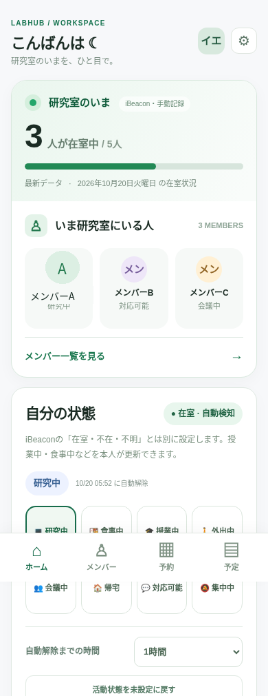
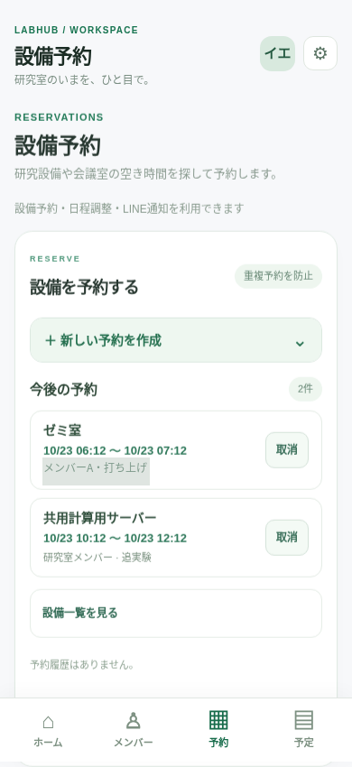
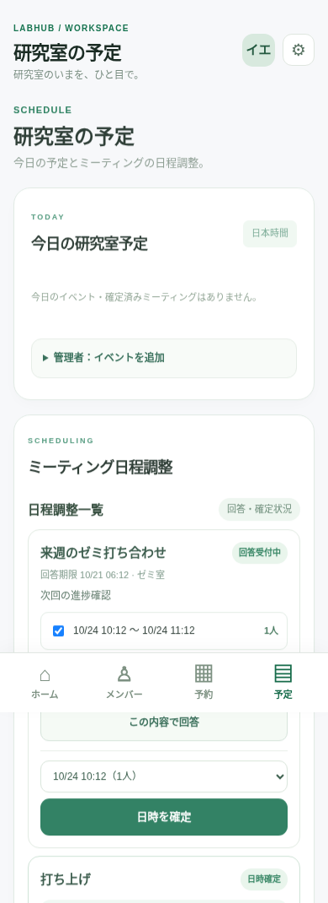
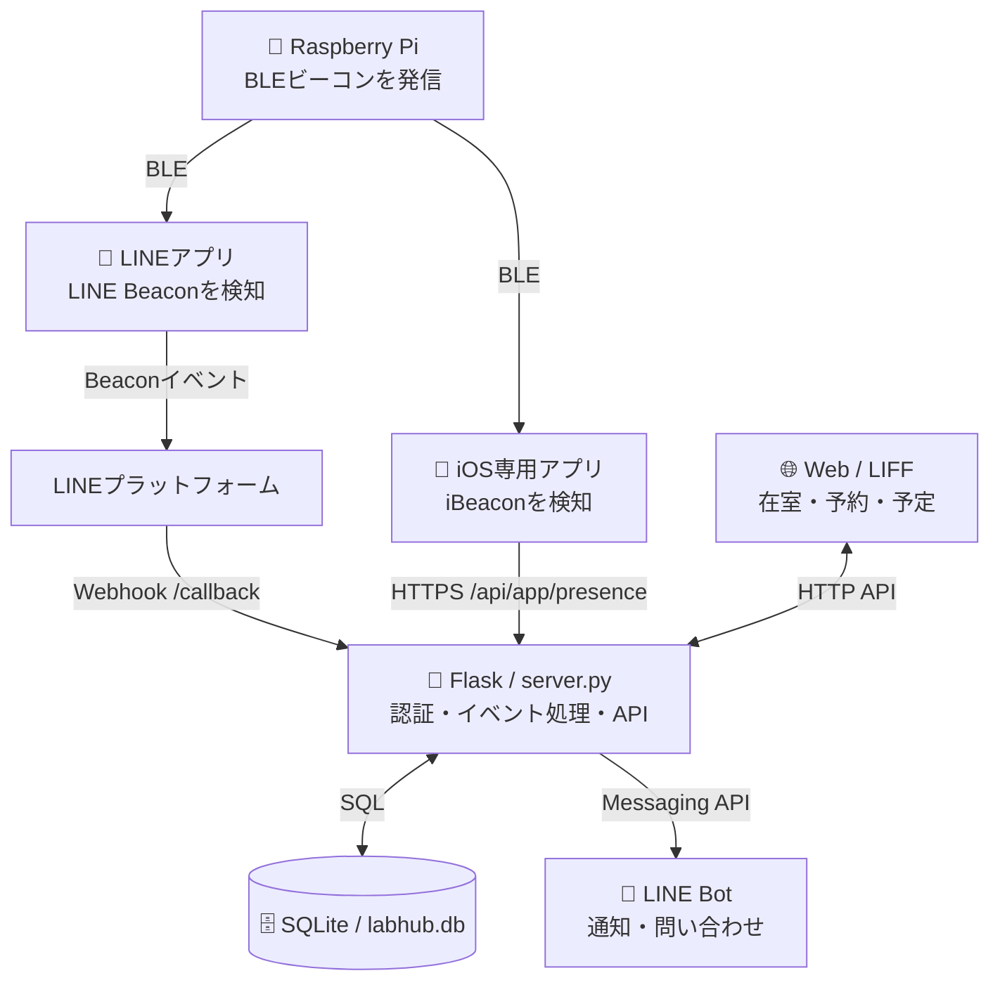

<div align="center">

# 🟢 LabHub

### 研究室の「いま」を、ひと目で。

**LINE Beacon × iBeacon × Web × SQLite** でつくる、研究室の在室・設備・予定管理システム


**[機能](#-主な機能) ・ [画面](#-スクリーンショット) ・ [仕組み](#-システム構成) ・ [導入](#-セットアップ) ・ [検証](#-検証結果と制約)**

</div>

---

## 💡 What is LabHub?

**LabHub（ラボハブ）** は、研究室の在室マグネットを発展させた、研究室向け情報共有プロトタイプです。

従来の在室マグネットには「更新を忘れやすい」「研究室の外から見られない」「履歴を活用できない」という課題があります。LabHubはビーコンによる入室検知とLINE連携でこれらを改善し、さらに研究設備の予約・ミーティングの日程調整を一つのWebアプリにまとめました。

| 従来の課題 | LabHubでのアプローチ |
| :-- | :-- |
| 在室マグネットを手動で更新する | LINE Beaconで入室を検知／専用iOSアプリでは入退室を検知 |
| 誰が研究室にいるか分からない | LINEのリッチメニューから在室メンバーを確認 |
| 「食事中」「授業中」などの状況が分からない | 位置状態と活動状態を分けて表示 |
| 設備予約や日程調整が別々 | SQLiteで予約・投票・確定を一元管理 |
| 在室情報を使い捨てにしている | 同意に基づく履歴集計から会議候補日時を提案 |

## 📱 スクリーンショット

<table>
<tr>
<td align="center"><b>ホーム / 在室状況</b></td>
<td align="center"><b>設備予約</b></td>
<td align="center"><b>ミーティング日程調整</b></td>
</tr>
<tr>
<td valign="top"></td>
<td valign="top"></td>
<td valign="top"></td>
</tr>
</table>

> 画像はデモ用のサンプルデータです。実際の研究室メンバーの個人情報や予約履歴ではありません。

## ✨ 主な機能

| 機能 | 内容 | 状態 |
| :-- | :-- | :-- |
| 📡 **LINE Beacon入室検知** | Raspberry PiのBLE信号をLINEアプリが検知し、Webhook経由で在室情報に反映 | 実装・入室動作確認済み |
| 📲 **iPhone専用アプリ** | CoreLocationでiBeaconの入室・退室を検知し、サーバーに送信 | 実機動作確認済み |
| 👥 **在室ダッシュボード** | 在室人数、メンバー名、最終更新などを表示 | 動作確認済み |
| 🍱 **活動ステータス** | 研究中・食事中・授業中・会議中などを本人が設定／期限付きで解除 | 保存・再読込を確認済み |
| 🔐 **LINE Login / LIFF** | LINEアカウントでログインし、管理者が研究室メンバーを承認 | 動作確認済み |
| 💬 **LINE Bot** | 入室通知や「誰いる？」への応答 | 動作確認済み |
| 🔔 **特定メンバーの来室通知** | 本人の同意がある場合に来室イベントを購読 | 実装済み・複数人検証待ち |
| 🖥️ **設備予約** | GPU・計算機・会議室を予約／SQLiteで時間重複を防止 | 予約・重複拒否を確認済み |
| 🗓️ **日程調整** | 候補日時の募集・投票・確定／会議室予約と連動 | 動作確認済み |
| 📊 **候補日時の推薦** | 会議室の空き時間と同意済み在室履歴をもとに提案 | 実装済み・精度評価は今後 |

## 🧩 システム構成

**ビーコンが人を直接識別するわけではありません。** Raspberry Piは電波を発信し、スマートフォン側が検知します。LabHubは2つの検知経路をサポートしています。



- **LINE Beacon方式：** 専用アプリ不要の入室検知。**退室を直接検知するイベントは利用できません。**
- **iPhone専用アプリ方式：** iBeaconの領域出入りを検知。実際の動作はiOSの制約やBLEの電波環境に左右されます。
- **Raspberry Pi：** BLE発信だけならモニター・インターネット接続は不要。Web更新とLINE通知にはサーバー側・スマートフォン側の通信が必要です。

### Technology Stack

| 層 | 採用技術 |
| :-- | :-- |
| Frontend | HTML / CSS / Vanilla JavaScript |
| Backend / API | Python / Flask |
| Database | SQLite |
| Authentication | LINE Login / LIFF / 管理者承認 |
| Notifications | LINE Messaging API / Webhook |
| Beacon | Raspberry Pi / BLE / BlueZ / LINE Simple Beacon / iBeacon |
| iOS | Swift / SwiftUI / CoreLocation |
| Network（開発時） | Cloudflare Tunnel |

## 🗂️ ディレクトリ構成

```text
LabHub/
├── README.md                    # 本ドキュメント
├── server.py                    # Webhook・LINEログイン・在室API
├── labhub_features.py          # 設備予約・日程調整・来室通知
├── schedule_suggestions.py     # 会議候補日時の推薦
├── run_reminders.py            # 予約開始前のLINEリマインダー
├── requirements.txt
├── templates/
│   └── index.html              # Web画面
├── static/                      # CSS / JavaScript
├── raspberry-pi/
│   └── line_beacon_labhub_test.py   # BLE広告プログラム
├── ios/
│   ├── LabHubBeacon.xcodeproj
│   └── LabHubBeacon/           # SwiftのiOSアプリ
├── docs/images/                # README用のデモ画像
└── test_v*.py                  # ユニットテスト
```

> SQLiteファイル、バックアップ、認証トークンはリポジトリに含めません。初回起動時のデータベースはアプリ側で作成されます。

## 🚀 セットアップ

<details>
<summary><b>1. Flaskサーバー（Windows / Python）</b></summary>

Python 3環境で依存ライブラリを導入します。

```powershell
python -m venv .venv
.\.venv\Scripts\Activate.ps1
pip install -r requirements.txt
```

LINE Developersで **Messaging APIチャネル** と **LINEログインチャネル** を用意し、必要な認証情報を環境変数に設定します。両方のチャネルは、ユーザーIDを共通に扱える構成で設定してください。

```powershell
$env:LINE_CHANNEL_SECRET = Read-Host "LINE Channel Secret"
$env:LINE_CHANNEL_ACCESS_TOKEN = Read-Host "LINE Channel Access Token"
$env:LABHUB_ADMIN_KEY = Read-Host "LabHub admin key"
$env:LABHUB_LIFF_ID = "<YOUR_LIFF_ID>"
$env:LINE_LOGIN_CHANNEL_ID = "<YOUR_LINE_LOGIN_CHANNEL_ID>"
python server.py
```

ブラウザで `http://localhost:5000` を開きます。LINE Webhookを受け取る場合は公開HTTPSのエンドポイントを用意し、Messaging API側に `https://<YOUR_DOMAIN>/callback` を設定してください。LIFFのエンドポイントにも同じWebサーバーのURLを設定します。

> **重要：** 開発時に用いたFlask開発サーバーとCloudflare Quick Tunnelは、常時公開・本番運用向けの構成ではありません。

</details>

<details>
<summary><b>2. Raspberry Pi（BLEビーコン）</b></summary>

Raspberry Pi OS / Debian系とBluetoothアダプターを想定しています。BlueZ D-Bus広告API用のライブラリが必要です。

```bash
sudo apt update
sudo apt install -y bluez python3-dbus python3-gi
sudo python3 raspberry-pi/line_beacon_labhub_test.py --hwid 0123456789
```

上記の `0123456789` は説明用のダミーHWIDです。LINE Simple BeaconのHWIDは、自分のLINE Developers環境で登録した10桁の16進文字列に置き換えてください。起動時にはLINE Simple Beacon、LINE互換iBeacon、LabHub専用iBeaconの広告を発信します。ビーコンを自動起動させる場合は `systemd` を利用できます。

</details>

<details>
<summary><b>3. iPhone専用アプリ（任意）</b></summary>

MacのXcodeで `ios/LabHubBeacon.xcodeproj` を開き、SigningのTeamと自分用のBundle Identifierを設定してiPhone実機へインストールします。

アプリでHTTPSのサーバーURLと、**承認済みLINEユーザーに紐づけた専用デバイストークン**を登録すると、検知イベントをFlaskへ送信できます。

サーバーでは環境変数 `LABHUB_APP_TOKENS` に、`<32文字以上のランダムトークン>:<LINEユーザーID>` の形式で登録してください。実トークンはREADME・ソースコード・Git履歴に保存しないでください。

自動入退室通知を有効にするには `LABHUB_NOTIFY_APP_EVENTS=1` も設定します。位置情報の「常に許可」などのiOS権限が必要です。

</details>

<details>
<summary><b>4. テストと予約リマインダー（任意）</b></summary>

```powershell
python -m unittest test_v53 -v
```

予約開始約10分前のLINE通知には、Flaskとは別にリマインダー処理を動かす必要があります。

```powershell
python run_reminders.py --loop
```

</details>

## 🧪 検証結果と制約

**確認できた内容（開発時の実機テスト）**

- iPhone専用アプリをスワイプ終了した状態での自動入退室 → Web更新 → LINE通知：**5回の試行すべてで成功**。
- 活動状態の変更がWeb再読み込み後も保持されることを確認。
- 設備予約の登録と、重複する時間帯の予約拒否を確認。
- ミーティングの日時確定後、会議室予約が作成されることを確認。
- LINE Beacon方式でも入室イベントの受信を確認。

**まだ検証・改善が必要なこと**

- 5回の成功は**専用iOSアプリの限定的な試験結果**であり、LINE Beacon方式の成功率や常時動作を保証するものではありません。
- LINE Beaconでは退室イベントを直接取得できないため、在室の確実な判定には限界があります。
- 長期間の誤検知率、複数端末・Androidでの運用、通知遅延などは十分に評価できていません。
- 「特定の人が来たら通知」は実装済みですが、複数のLINEアカウントでの実動作確認が必要です。
- 過去の在室傾向による日程推薦は**本人同意制**で、実際の参加可否を推定・保証するものではありません。推薦精度も評価途中です。
- 現行の認証・管理者キー・公開構成はプロトタイプ向けです。実運用には権限管理、監査、バックアップ、保存期間の整備が必要です。

## 🔒 プライバシーと公開時の注意

- 在室・行動履歴は個人に関わる情報です。利用者の同意を得て、閲覧範囲・保存期間・削除方法を設計してください。
- `.env`、`labhub.db`、`*.db`、`beacon_events.jsonl`、バックアップファイル、トークン、LINEのシークレット情報は**GitHubに公開しない**でください。
- 画面サンプルには架空のデータを使用しています。実際のLINEトーク画面やユーザーIDを載せる場合は、匿名化・許諾を確認してください。

## 🛣️ Future Work

- 安定した常時稼働サーバーと固定HTTPS URLへの移行
- 在室情報の鮮度判定・誤検知対策
- LINE「来室通知」の複数ユーザー検証と「対応可能になったら通知」の追加
- 設備利用状況の可視化、日程推薦の定量評価
- 複数人の研究室での継続的なユーザビリティ評価

---

<div align="center">
<sub>LabHub — 在室情報を、研究室のコミュニケーションにつなげる。</sub>
</div>
