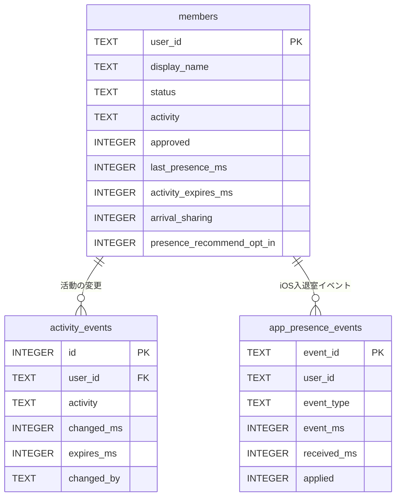
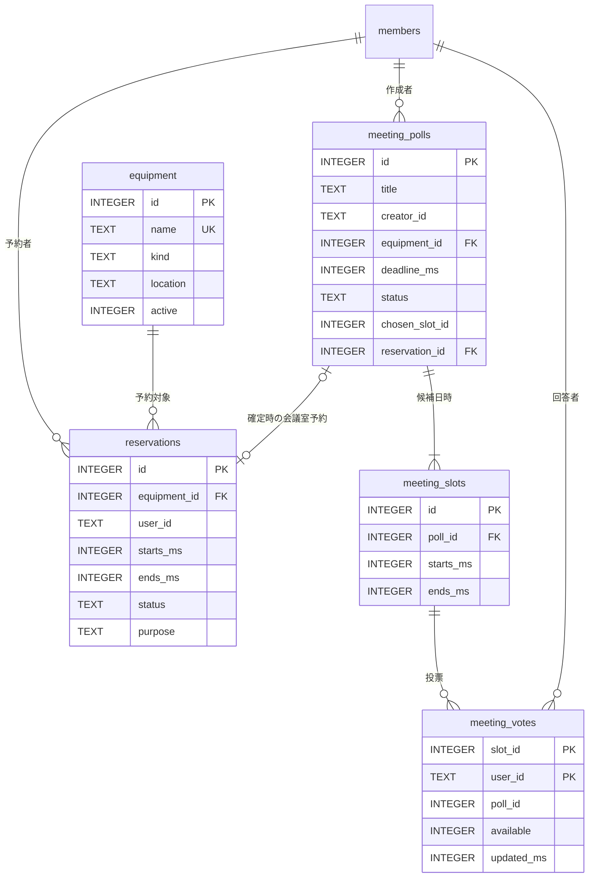
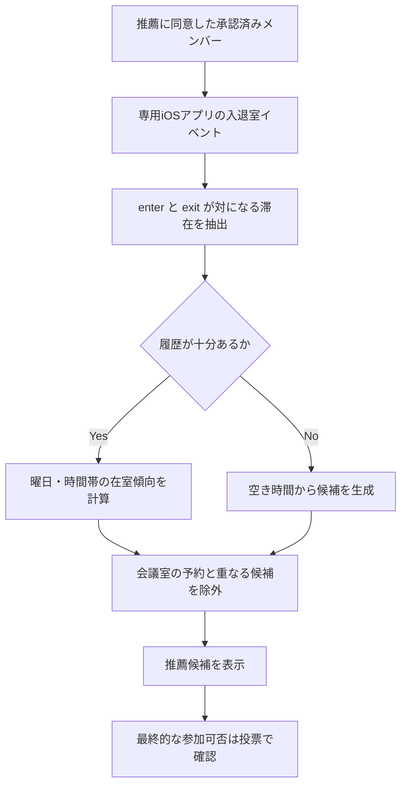

# 🗄️ LabHub Database Design

> **SQLiteを用いた研究室向け情報管理** | 対象: LabHub v5.4 | [← READMEに戻る](../README.md)

LabHubは、在室情報を表示するだけでなく、**ユーザー・行動履歴・設備予約・ミーティングの投票結果をSQLiteで関連付けて管理**しています。本資料では、実装コードに基づき、データモデルと主要なSQL処理を紹介します。

| 設計のポイント | 実装上の工夫 |
| :-- | :-- |
| 👤 **共通ID** | LINEユーザーIDを `members.user_id` に保存し、在室・予約・投票・通知を紐付ける |
| 📍 **状態と履歴の分離** | 最新の状態は `members`、イベント履歴は別テーブルに記録する |
| 🗓️ **予約の整合性** | 予約時間の重複判定と `BEGIN IMMEDIATE` を組み合わせる |
| 🗳️ **日程調整の正規化** | アンケート・候補日時・投票を別テーブルに分離する |
| 🔒 **プライバシー** | 来室通知と履歴ベースの推薦を、本人の許可設定に基づいて制御する |

> **スコープについて：** 以下は `server.py`・`labhub_features.py`・`schedule_suggestions.py` の実装を読み取って作成した設計資料です。ER図は**アプリケーション上の論理的な関連**を示し、すべてがSQLiteの外部キー制約として宣言・強制されているわけではありません。

---

## 1. データモデル（ER図）

### 1-1. 在室・活動履歴



- **`members`**：各メンバーの現在の在室状態（`present` / `away`）、活動状態、最終検知時刻、承認・同意フラグを保持します。画面の「不明」は、最新状態の時刻等を踏まえてアプリ側で表現する場合があります。
- **`activity_events`**：活動状態の変更履歴。`user_id` は `members` を参照する外部キーとして宣言されています。
- **`app_presence_events`**：専用iPhoneアプリから受信した `enter` / `exit` / `test` を保存し、`event_id` によって重複受信を識別します。`applied` は実際の在室状態更新に採用したかどうかを表します。

**補足：** LINE Beacon側の受信履歴は、現行実装ではSQLiteの `app_presence_events` ではなく、別の `beacon_events.jsonl` にも記録しています。両者を「SQLiteに統合済みの入退室履歴」と混同しないようにしています。

### 1-2. 設備予約・日程調整



- **`equipment`**：共有計算機・GPU・会議室などの設備マスタ。`kind` は `equipment`（研究設備）または `room`（会議室）です。
- **`reservations`**：誰が・どの設備を・いつ使うか。`status='active'` の予約のみ重複判定の対象です。取消時は行を削除せず、`cancelled` に変更します。
- **`meeting_polls`**：議題・回答期限・作成者・確定状態。希望する会議室を `equipment_id` で関連付けます。
- **`meeting_slots`**：1つの日程調整に対して、複数の開始・終了時刻を持つ候補を登録します。
- **`meeting_votes`**：誰がどの候補に参加できるかを保持します。**`PRIMARY KEY(slot_id, user_id)`** により、同じ候補への同じ人の回答が重複しません。

会議室を指定して日時を確定すると、`reservations` に会議室予約を作成し、そのIDを `meeting_polls.reservation_id` に保存します。

### 1-3. 通知・その他のテーブル

| テーブル | 主な用途 | 識別キー |
| :-- | :-- | :-- |
| `arrival_watches` | 「特定の人が来たら通知」の購読設定 | `(watcher_id, target_id)` |
| `arrival_notification_log` | 同じ相手への短時間の重複通知を抑制 | `(watcher_id, target_id)` |
| `reminder_log` | 設備予約の事前通知の試行結果 | `reservation_id` |
| `lab_events` | 研究室イベントの登録と当日表示 | `id` |

これらは**本体機能に付随するテーブル**で、予約の履歴や在室イベントと同じDBファイルで管理します。

---

## 2. SQLの実装例：予約時間の重複防止

研究設備は、同じ時間帯に二重予約できないようにする必要があります。LabHubでは、2つの半開区間 `[開始, 終了)` が重なる条件をSQLで判定しています。

```sql
-- 「既存の開始 < 新規の終了」かつ「既存の終了 > 新規の開始」
SELECT 1
FROM reservations
WHERE equipment_id = ?
  AND status = 'active'
  AND starts_ms < ?   -- 新規予約の終了時刻
  AND ends_ms > ?     -- 新規予約の開始時刻
LIMIT 1;
```

例：既存予約が **10:00–11:00** の場合、**10:30–11:30 は重複**しますが、**11:00–12:00 は重複しません**。

<details>
<summary><strong>🔍 なぜこの条件で重複を判定できるのか</strong></summary>

```text
既存予約   10:00 ├──────────┤ 11:00
重複する             10:30 ├──────────┤ 11:30
重複しない                       11:00 ├──────────┤ 12:00
```

「開始時刻が同じか」だけでなく、**途中から始まる予約や、既存予約を包含する予約**も検出できます。

</details>

### 同時予約への対策：トランザクション

重複検索と予約追加を別々に処理すると、同時に予約ボタンを押した2人がどちらも「空きあり」と判断する競合が起こり得ます。LabHubでは、以下の処理を**同じ書き込みトランザクション**内で実行します。

```python
# labhub_features.py の処理を説明用に簡略化
with connect_db() as db:
    db.execute("BEGIN IMMEDIATE")

    if _conflict(db, equipment_id, start_ms, end_ms):
        return jsonify(error="その時間帯は予約済みです"), 409

    db.execute(
        """INSERT INTO reservations
           (equipment_id, user_id, starts_ms, ends_ms, purpose, created_ms)
           VALUES (?, ?, ?, ?, ?, ?)""",
        (equipment_id, user_id, start_ms, end_ms, purpose, now_ms()),
    )
# connect_db() の正常終了時に COMMIT
```

**`BEGIN IMMEDIATE`** は書き込み予約を早い段階で確保するため、同じSQLite DBファイルを使う複数リクエストの競合を防ぎやすくします。予約登録だけでなく、**日程確定時に会議室の空き状況を再確認する処理**でも利用しています。

**インデックス：** `idx_reservations_equipment_time` を `(equipment_id, starts_ms, ends_ms)` に作成しています。設備と時間による検索を効率化する目的です。

---

## 3. 日程調整：複数テーブルを使う理由

例：3つの候補から参加できる日時を選んでもらう場合、データは次のように分かれます。

```text
meeting_polls    打ち合わせ（議題・回答期限・作成者）
   ├── meeting_slots    候補A 10:00–11:00
   │      └── meeting_votes  Aさん: 参加可 / Bさん: 参加不可
   ├── meeting_slots    候補B 14:00–15:00
   │      └── meeting_votes  Aさん: 参加可 / Bさん: 参加可
   └── meeting_slots    候補C 16:00–17:00
          └── meeting_votes  Aさん: 参加不可 / Bさん: 参加可
```

候補日時と投票を別テーブルにしているので、人数や候補が増えても**同じ列を何度も追加せずに対応**できます。投票は次のUPSERT構文で再回答できます。

```sql
INSERT INTO meeting_votes
    (poll_id, slot_id, user_id, available, updated_ms)
VALUES (?, ?, ?, ?, ?)
ON CONFLICT(slot_id, user_id) DO UPDATE SET
    available = excluded.available,
    updated_ms = excluded.updated_ms;
```

> `meeting_votes` の一意性は「候補ID × ユーザーID」で担保しています。候補が所属する日程調整との整合性は、現状では主にAPI側で確認する構成です。

---

## 4. 在室履歴を利用した会議日時の推薦

[`schedule_suggestions.py`](../schedule_suggestions.py) では、以下の処理を行います。



**推薦ロジックの主要条件**

| 項目 | 実装内容 |
| :-- | :-- |
| 参照範囲 | 過去42日間の履歴を中心に集計 |
| 対象者 | 承認済み、かつ `presence_recommend_opt_in = 1` のメンバーのみ |
| イベント | `app_presence_events` の適用済み `enter` / `exit` の組のみ |
| 滞在時間 | 2分以上・12時間以下の記録を利用 |
| 履歴に基づく推薦を開始する条件 | 同意者2名以上・記録のあるユーザー2名以上・3日以上の履歴・5件以上の滞在記録 |
| 候補生成 | 指定開始日から7日間、9〜19時の範囲で30分刻みの候補を検討 |
| 空き確認 | `reservations` から会議室の予約済み時間を除外 |

データが不足する場合は、履歴を根拠に順位付けせず、**空き時間ベースの推薦**へ切り替えます。また、個々のメンバーの詳細な行動時刻は推薦APIで公開しません。

**注意：** 研究室によくいる時間帯と、会議に参加できる時間帯は同じではありません。この機能は会議候補を提案するだけであり、**実際の参加可否は本人の投票で確定**します。

---

## 5. データ保存とインデックス

### 時刻の保存形式

`*_ms` という列名は、**Unixエポックからのミリ秒**を表します。画面表示では日本時間（JST）に変換します。

```text
starts_ms       設備予約・会議の開始時刻
ends_ms         設備予約・会議の終了時刻
event_ms        端末がイベントを検知した時刻
received_ms     サーバーがイベントを受信した時刻
changed_ms      活動状態が変更された時刻
```

検知時刻と受信時刻を分離すると、**通信による遅延や古いイベントの扱い**を判断できます。

### コードで作成するインデックス

| インデックス名 | 対象テーブル・列 | 目的 |
| :-- | :-- | :-- |
| `idx_reservations_equipment_time` | `reservations(equipment_id, starts_ms, ends_ms)` | 設備ごとの時間検索 |
| `idx_app_events_user_time` | `app_presence_events(user_id, event_ms)` | 個人別の時系列イベント参照 |
| `idx_activity_events_user_time` | `activity_events(user_id, changed_ms DESC)` | 活動変更履歴の表示 |

---

## 6. 公開・運用時の注意点

- **実際のDBファイルは公開しない**：`labhub.db` にはLINEユーザーIDや行動履歴などが含まれ得ます。GitHubにはスキーマとプログラムのみ公開します。
- **同意とアクセス制御**：来室通知・在室履歴を使う推薦は本人の許可に基づきます。研究室内で使う場合も、閲覧権限と情報の利用目的を明確にする必要があります。
- **外部キー制約は今後の改善点**：ソース中の一部テーブルには `REFERENCES` が宣言されていますが、接続時の `PRAGMA foreign_keys = ON` は現行コードで設定されていません。その他のIDの関係もアプリ側の検証に依存します。実運用では、SQLite側でも参照整合性を強制するよう改善が必要です。
- **競合対策の適用範囲**：トランザクションはSQLite DBファイルへの同時操作を制御しますが、複数サーバー・大規模運用の性能を保証するものではありません。
- **履歴の管理**：保存期間、本人からの削除依頼、バックアップの暗号化・復元手順は今後整備する必要があります。

## 7. 対応する実装ファイル

| ファイル | 確認できる実装 |
| :-- | :-- |
| [`server.py`](../server.py) | DB接続と初期化、在室更新、活動履歴、iOSイベント重複排除 |
| [`labhub_features.py`](../labhub_features.py) | テーブル定義、設備・予約、日程調整と投票、来室通知設定 |
| [`schedule_suggestions.py`](../schedule_suggestions.py) | 在室履歴の抽出と会議候補の推薦 |
| [`test_v5.py`](../test_v5.py) | 予約の競合、会議日時の確定等のテスト |
| [`test_v53.py`](../test_v53.py) | 設備区分と日程推薦のテスト |

---

<div align="center">
<sub>LabHub — SQLiteで「現在の状態」を「次の行動を支える情報」へ。</sub>
</div>
